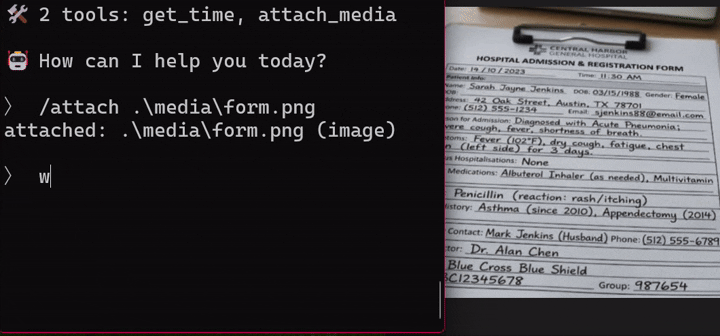

# litertlm-go

[](https://pkg.go.dev/github.com/vladimirvivien/litertlm-go)

A high-performance Go binding for Google's [LiteRT-LM](https://github.com/google-ai-edge/LiteRT-LM) runtime, designed for local on-device/edge LLM inference.

> Inspired by Hybridgroup's [Yzma](https://github.com/hybridgroup/yzma).

📖 **Full documentation:** [vladimirvivien.github.io/litertlm-go](https://vladimirvivien.github.io/litertlm-go/)

---

## 🔥 Features 

* 📦 **Automated Provisioning** — Automatically download, cache, and stage official LiteRT-LM prebuilts (`FetchLib`, including Windows DXC binaries) and `.litertlm` models from Hugging Face (`FetchModel`) directly in Go.
* 🔬 **Model Inspection & Structured Diagnostics** — Inspect `.litertlm` modalities, thinking support, function calling, and sampler defaults without booting an engine (`InspectModel`), and match native C errors with `StatusCode` sentinels and thread-local messages (`*CError`, `APIVersion`).
* ⚙️ **Centralized Configuration** — Load engine and sampler configurations from a shared `config.json` profile file (`WithConfigFile`).
* 💬 **Stateful Chat & Conversations** — Multi-turn chat orchestration with system prompts, custom prompt templates (`WithPromptTemplate`), thinking budgets (`ThinkingConfig`), transcript seeding, KV-cache channel filtering, and branching (`Chat.Clone`).
* 🎯 **Constrained Decoding & Logit Controls** — Enforce JSON Schema or regex grammars (`WithConstraint`, `ConstraintProviderLLGuidance`), apply repetition/presence/frequency penalties, block repeated n-grams, and suppress specific token IDs.
* 🖼️ **Multimodal Inputs** — Process text, image, and audio inputs in any order using a unified Go interface.
* 🛠️ **Automated Tool Calling** — Register Go functions as tools with automatic dispatch, streaming tool calls, per-tool error recovery policies, and OpenAI-style `ToolChoice` policies (C API `1.1+`).
* 📐 **Structured JSON Output** — Extract model outputs directly into Go structs with type-safe generic helpers (`GenerateData[T]`, `GenerateDataMulti[T]`).
* ⚡ **Hardware Acceleration & Speculative Decoding** — Run on CPU (XNNPACK / YNNPACK), GPU (WebGPU / Direct3D 12 / Metal), or NPU with configurable speculative decoding (`Off`, `On`, `Adaptive`).
* 🔍 **Low-Level Control** — Access the LiteRT-LM C API for custom prefill/decode loops, KV-cache checkpoints and rewinding, session cloning, async decode, scoring, tokenization, and file-descriptor loading.

---

## Install

```bash
go get github.com/vladimirvivien/litertlm-go@latest
```

---

## Quickstart (with Automated Provisioning)

Download the native LiteRT-LM libraries and model artifact directly in Go:

```go
package main

import (
	"context"
	"fmt"
	"log"
	"runtime"

	"github.com/vladimirvivien/litertlm-go/pkg/litertlm"
)

func main() {
	ctx := context.Background()

	// 1. Fetch prebuilt shared libraries automatically (cached locally)
	libDir, err := litertlm.FetchLib(ctx, runtime.GOOS, runtime.GOARCH, "v0.19.1")
	if err != nil {
		log.Fatalf("FetchLib failed: %v", err)
	}

	// 2. Download model from Hugging Face automatically (cached locally)
	modelPath, err := litertlm.FetchModel(ctx, "litert-community/gemma3-1b-it-int4")
	if err != nil {
		log.Fatalf("FetchModel failed: %v", err)
	}

	// 3. Initialize client and generate text
	client, err := litertlm.New(ctx,
		litertlm.WithLib(libDir),
		litertlm.WithModel(modelPath),
	)
	if err != nil {
		log.Fatalf("Initialization failed: %v", err)
	}
	defer client.Close()

	text, err := client.Generate(ctx, "Write a short poem about coding in Go.")
	if err != nil {
		log.Fatalf("Generation failed: %v", err)
	}
	fmt.Println(text)
}
```

### Manual Provisioning

You can optionally run with pre-existing local libraries and model paths:

```bash
LITERTLM_LIB=/abs/path/to/dist/lib \
LITERTLM_MODEL=/abs/path/to/gemma3-1b-it-int4.litertlm \
    go run main.go
```

> To run on the GPU backend, configure initialization with `litertlm.WithBackend("gpu")` (defaults to `"cpu"`).

---

## Provisioning & Staging

* **Automated Provisioning (Go):** Use `litertlm.FetchLib` and `litertlm.FetchModel`.
* **Linux / macOS Manual Staging:** [`LITERTLM-BUILD.md`](./LITERTLM-BUILD.md)
* **Windows Manual Staging & DXC Setup:** [`LITERTLM-BUILD-WINDOWS.md`](./LITERTLM-BUILD-WINDOWS.md)

> [!NOTE]
> Minimum supported upstream C-API runtime: **LiteRT-LM v0.19.1** (C API `1.0.0`).

---

## Running Examples

Every example in `examples/` supports automated provisioning flags for zero-configuration execution:

```bash
# Automatically fetch dependencies and run:
go run ./examples/hello -get-lib v0.19.1 -get-model litert-community/gemma3-1b-it-int4

# Inspect model modalities, thinking, tool calling, and sampler defaults:
go run ./examples/capabilities -get-lib v0.19.1 -get-model litert-community/gemma-4-E2B-it

# Enforce JSON Schema output with grammar-constrained decoding:
go run ./examples/constrained-json -get-lib v0.19.1 -get-model litert-community/gemma3-1b-it-int4

# Multi-branch KV-cache checkpoints, rewinding, and session cloning:
go run ./examples/checkpoints -get-lib v0.19.1 -get-model litert-community/gemma3-1b-it-int4

# Automated tool-calling with Go struct reflection:
go run ./examples/autotool -get-lib v0.19.1 -get-model litert-community/gemma3-1b-it-int4
```

See [`examples/README.md`](./examples/README.md) for the complete index of 43 runnable examples.

### Multimodal Demo

[`examples/bot`](./examples/bot) demonstrates multimodal capabilities (e.g. OCR and structured entity extraction from images):



---

## Documentation

* [Getting Started](https://vladimirvivien.github.io/litertlm-go/getting-started/) — Installation, provisioning workflows, and model inspection
* [Client Guide](https://vladimirvivien.github.io/litertlm-go/client/) — Client configuration, profiles, errors, unary generation, and options
* [Chat Guide](https://vladimirvivien.github.io/litertlm-go/chat/) — Multi-turn dialogue, thinking, constraints, logit penalties, and cloning
* [Tools Guide](https://vladimirvivien.github.io/litertlm-go/tools/) — Typed and raw tools, dispatch policies, and tool selection
* [Structured Output](https://vladimirvivien.github.io/litertlm-go/structured-output/) — JSON extraction via `GenerateData[T]` and grammar constraints
* [Low-Level API](https://vladimirvivien.github.io/litertlm-go/low-level/) — Prefill/decode, checkpoints, cloning, scoring, and handle lifetimes
* [Supported Models](https://vladimirvivien.github.io/litertlm-go/models/) — Model support matrix, memory sizing, and tuning
* [Troubleshooting](https://vladimirvivien.github.io/litertlm-go/troubleshooting/) — Debugging loader, constraints, sampler, and acceleration issues

---

## License

Apache-2.0, matching upstream LiteRT-LM.
