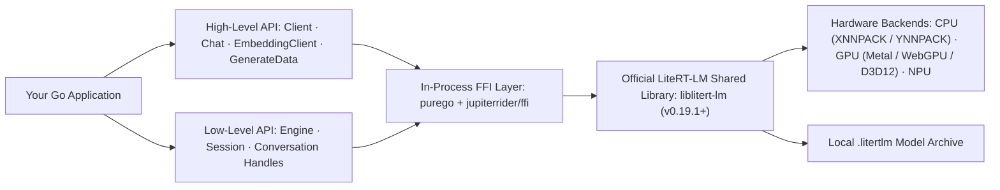

<div class="lrt-hero" markdown>

<div class="lrt-hero-badges">
  <span class="lrt-pill lrt-pill--coral">Go 1.26+</span>
  <span class="lrt-pill lrt-pill--teal">LiteRT-LM C API 1.0–1.1</span>
  <span class="lrt-pill lrt-pill--gold">Linux · macOS · Windows</span>
  <span class="lrt-pill lrt-pill--plum">No C Compiler Required</span>
</div>

<h1 class="lrt-hero-title">Run Local AI Models <span class="lrt-gradient-text">Right Inside Go</span></h1>

<p class="lrt-hero-lead">
  <code>litertlm-go</code> brings Google's LiteRT-LM inference runtime straight into your Go applications — streaming text, vision and audio understanding, multimodal embeddings, typed Go tool calling, and structured JSON with no sidecar server.
</p>

<div class="lrt-hero-actions" markdown>

[Get Started in 5 Minutes](getting-started.md){ .md-button .lrt-btn-primary }
[Follow a Tutorial](tutorials.md){ .md-button .lrt-btn-secondary }
[Browse 48 Examples](examples.md){ .md-button }

</div>

</div>

<div class="lrt-install-strip" markdown>

<span class="lrt-install-label">:material-package-down: Add the Go module to your project</span>

```bash
go get github.com/vladimirvivien/litertlm-go@latest
```

</div>

## See It in 15 Lines

Choose the workflow that fits what you are building. Each snippet runs in-process and can fetch its native library and model automatically on first run.

=== "Quickstart"

    ```go
    ctx := context.Background()

    libDir, err := litertlm.FetchLib(ctx, runtime.GOOS, runtime.GOARCH, "v0.19.1")
    if err != nil { log.Fatal(err) }

    modelPath, err := litertlm.FetchModel(ctx, "litert-community/gemma3-1b-it-int4")
    if err != nil { log.Fatal(err) }

    client, err := litertlm.New(ctx, litertlm.WithLib(libDir), litertlm.WithModel(modelPath))
    if err != nil { log.Fatal(err) }
    defer client.Close()

    for chunk, err := range client.GenerateStream(ctx, "Write a haiku about local AI.") {
        if err != nil { log.Fatal(err) }
        fmt.Print(chunk.Text)
    }
    ```

=== "Vision Q&A"

    ```go
    client, err := litertlm.New(ctx,
        litertlm.WithLib(libDir),
        litertlm.WithModel(visionModelPath),
        litertlm.WithVisionBackend("cpu"),
        litertlm.WithMaxTokens(4096),
    )
    if err != nil { log.Fatal(err) }
    defer client.Close()

    img, err := litertlm.ImageFromFile("scene.png")
    if err != nil { log.Fatal(err) }

    answer, err := client.GenerateMulti(ctx, []litertlm.Part{
        img,
        litertlm.Text("List the objects on the table."),
    })
    ```

=== "Typed JSON"

    ```go
    type Recipe struct {
        Title       string   `json:"title"`
        Ingredients []string `json:"ingredients"`
        Steps       []string `json:"steps"`
    }

    recipe, err := litertlm.GenerateData[Recipe](ctx, client,
        "Share a quick sourdough pancake recipe.",
        litertlm.WithRetries(2),
    )
    if err != nil { log.Fatal(err) }

    fmt.Println(recipe.Title, recipe.Ingredients)
    ```

=== "Embeddings"

    ```go
    embedder, err := litertlm.NewEmbeddingClient(ctx,
        litertlm.WithLib(libDir),
        litertlm.WithModel(embedModelPath),
    )
    if err != nil { log.Fatal(err) }
    defer embedder.Close()

    vec, err := embedder.Embed(ctx, "task: search query | text: parked cars",
        litertlm.WithNormalize(true),
        litertlm.WithOutputSize(256), // Matryoshka slice
    )
    ```

---

## What You Can Build

Explore the full surface of `litertlm-go`, from one-line generation up to direct control of KV caches and model sections.

<div class="grid cards" markdown>

-   :material-rocket-launch:{ .lg .middle } __Zero-Hassle Provisioning & Delta Sync__

    ---

    Download prebuilt LiteRT-LM shared libraries (`FetchLib`), stream `.litertlm` models from Hugging Face (`FetchModel`), and reuse unchanged sections on updates (`PlanModelSync`, `SyncModelCache`, C API `1.1+`).

    [:octicons-arrow-right-24: Getting started](getting-started.md)

-   :material-chat-processing:{ .lg .middle } __Stateful Multi-Turn Chat__

    ---

    Keep conversation history cleanly with system prompts, custom prompt templates, transcript seeding (`WithInitialMessages`), thinking budgets, and O(1) conversation branching (`Chat.Clone`).

    [:octicons-arrow-right-24: Chat guide](chat.md)

-   :material-image-multiple:{ .lg .middle } __Vision & Audio Multimodal__

    ---

    Combine `Text`, `ImageFromFile`, and `AudioFromFile` parts in one-shot `GenerateMulti` calls or multi-turn `Chat.SendMulti` sessions with vision token budgets.

    [:octicons-arrow-right-24: Multimodal inputs](client.md#multimodal-inputs)

-   :material-vector-polyline:{ .lg .middle } __Multimodal Embeddings & Search__

    ---

    Vectorize text, images, and audio in one shared embedding space using `EmbeddingClient`, batch processing, overflow chunking, and Matryoshka dimension truncation.

    [:octicons-arrow-right-24: Embeddings guide](embeddings.md)

-   :material-wrench:{ .lg .middle } __Typed Go Tool Calling__

    ---

    Reflect Go structs into JSON Schemas with `RegisterTool`, auto-dispatch multi-hop tool calls sequentially or concurrently, recover on transient tool errors, and enforce `ToolChoice` policies (`1.1+`).

    [:octicons-arrow-right-24: Tools guide](tools.md)

-   :material-code-json:{ .lg .middle } __Structured JSON & Grammar Decoding__

    ---

    Populate typed Go structs with `GenerateData[T]` and `GenerateDataMulti[T]`, or enforce decode-time JSON Schema and regex constraints (`WithConstraint`) with logit penalties.

    [:octicons-arrow-right-24: Structured output](structured-output.md)

-   :material-speedometer:{ .lg .middle } __Hardware Acceleration & Diagnostics__

    ---

    Inspect `.litertlm` capabilities without booting an engine (`InspectModel`), tune CPU (XNNPACK / YNNPACK) or GPU (Metal / WebGPU / D3D12), enable speculative decoding, and capture AI Edge Debugger traces (`1.1+`).

    [:octicons-arrow-right-24: Models & scaling](models.md)

-   :material-memory:{ .lg .middle } __Direct Low-Level Engine Control__

    ---

    Drop down to `Engine`, `Session`, and `Conversation` handles for explicit `RunPrefill` / `RunDecode`, KV-cache checkpoints (`SaveCheckpoint` / `RewindToCheckpoint`), log-prob scoring, tokenization, and `WithModelFD`.

    [:octicons-arrow-right-24: Low-level API](low-level.md)

</div>

---

## How It Fits Together

Your Go binary loads the official LiteRT-LM shared library dynamically in-process via `purego` and FFI—no C compiler toolchain at build time and no separate Python or HTTP model server at runtime.



---

## Pick Your Starting Point

Ready to write code or browse real programs? Jump straight to the path that matches your goal.

<div class="grid cards" markdown>

-   :material-lightning-bolt:{ .lg .middle } __New to `litertlm-go`?__

    ---

    Install the module, fetch prebuilt binaries in Go, and run your first prompt locally in minutes.

    [:octicons-arrow-right-24: Start the setup guide](getting-started.md)

-   :material-compass-outline:{ .lg .middle } __Prefer Hands-On Tutorials?__

    ---

    Build four complete projects: streaming + benchmarks, vision extraction, semantic search, and tool-calling agents.

    [:octicons-arrow-right-24: Open the tutorials](tutorials.md)

-   :material-code-braces:{ .lg .middle } __Want Copy-Ready Code?__

    ---

    Browse all 48 runnable CLI examples organized by task with one-command `go run` invocations.

    [:octicons-arrow-right-24: Explore 48 examples](examples.md)

-   :material-chip:{ .lg .middle } __Sizing RAM, VRAM & Models?__

    ---

    Compare Gemma 4, Gemma 3, EmbeddingGemma 2, Qwen 3, and Phi-4 memory footprints and backend flags.

    [:octicons-arrow-right-24: View supported models](models.md)

</div>

---

> Inspired by Hybridgroup's [Yzma](https://github.com/hybridgroup/yzma) · Minimum runtime: **LiteRT-LM v0.19.1** (C API `1.0.0+`) · Licensed under **Apache-2.0**.
