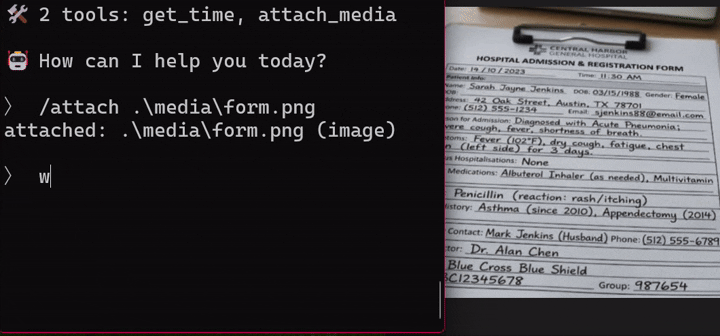

# Vision Q&A & Structured JSON Extraction

Local multimodal models can read receipts, inspect UI screenshots, analyze photographs, and return clean Go structs without uploading images to a third-party API. In this tutorial, you configure a vision-enabled `Client`, ask natural-language questions about an image, extract typed Go structs with `GenerateDataMulti[T]`, and contrast that approach with decode-time grammar constraints (`WithConstraint`).

<div class="lrt-meta-bar">
  <span class="lrt-pill lrt-pill--coral">~10 min</span>
  <span class="lrt-pill lrt-pill--teal">Vision + Structured Data</span>
  <span class="lrt-pill lrt-pill--gold">Gemma 4 E2B / E4B</span>
  <span class="lrt-pill lrt-pill--plum">CPU or GPU</span>
</div>

<div class="lrt-media-frame" markdown>



<p class="lrt-media-caption">On-device image understanding and structured JSON extraction running locally via <code>litertlm-go</code>.</p>

</div>

---

## Step 1 — Configure a Vision-Capable `Client`

Multimodal `.litertlm` artifacts pair a text decoder with a separate vision encoder. Two client options matter specifically when handling images:

1. **`litertlm.WithVisionBackend("cpu")` (or `"gpu"`):** Enables the vision executor. Leaving it unset disables image inputs even when the model file includes a vision encoder.
2. **`litertlm.WithMaxTokens(4096)` (or higher):** Image patches expand into hundreds of visual tokens during prefill; a small token budget (such as `512`) leaves too little headroom for both visual tokens and output text.

```go
package main

import (
	"context"
	"encoding/json"
	"errors"
	"fmt"
	"log"
	"runtime"

	"github.com/vladimirvivien/litertlm-go/pkg/litertlm"
)

func openVisionClient(ctx context.Context, modelIDOrPath string) (*litertlm.Client, error) {
	libDir, err := litertlm.FetchLib(ctx, runtime.GOOS, runtime.GOARCH, "v0.19.1")
	if err != nil {
		return nil, err
	}
	modelPath, err := litertlm.FetchModel(ctx, modelIDOrPath)
	if err != nil {
		return nil, err
	}

	litertlm.SetMinLogLevel(litertlm.LogQuiet)
	return litertlm.New(ctx,
		litertlm.WithLib(libDir),
		litertlm.WithModel(modelPath),
		litertlm.WithBackend("cpu"),
		litertlm.WithVisionBackend("cpu"),
		litertlm.WithMaxTokens(4096),
	)
}
```

!!! tip "Verify Vision Support First"

    Before booting an engine, check `caps, err := litertlm.InspectModel(modelPath)` and confirm `caps.SupportsVision()` is `true`.

---

## Step 2 — Run Free-Form Vision Q&A (`GenerateMulti`)

Pass an ordered slice of `litertlm.Part` values into `client.GenerateMulti`. Helper constructors such as `litertlm.ImageFromFile` detect the image MIME type from file extensions (`jpeg`, `png`, `webp`, `gif`, `bmp`) and validate the bytes before calling native code:

```go
func describeImage(ctx context.Context, client *litertlm.Client, imagePath string) error {
	img, err := litertlm.ImageFromFile(imagePath)
	if err != nil {
		return err
	}

	reply, err := client.GenerateMulti(ctx, []litertlm.Part{
		img,
		litertlm.Text("Describe the objects visible in this image in two crisp sentences."),
	})
	if err != nil {
		return err
	}

	fmt.Println("=== Vision Description ===")
	fmt.Println(reply)
	return nil
}
```

`client.GenerateMulti` runs as a single independent turn. If you want to follow up with additional questions referencing the same uploaded image without re-encoding image patches, open a [`Chat`](chat.md#multimodal-turns-sendmulti-and-sendmultistream) and call `chat.SendMulti` followed by `chat.Send`.

---

## Step 3 — Extract Typed Go Structs (`GenerateDataMulti[T]`)

Unstructured descriptions are great for human readers, but backend pipelines need predictable fields. `litertlm.GenerateDataMulti[T]` inspects any Go struct `T`, synthesizes a JSON capture tool (or schema hint fallback), retries on malformed responses via `litertlm.WithRetries`, and returns a populated `*T`:

```go
type Scene struct {
	Description string   `json:"description"`
	Objects     []string `json:"objects"`
}

func extractScene(ctx context.Context, client *litertlm.Client, imagePath string) error {
	img, err := litertlm.ImageFromFile(imagePath)
	if err != nil {
		return err
	}

	scene, err := litertlm.GenerateDataMulti[Scene](ctx, client,
		[]litertlm.Part{
			img,
			litertlm.Text("Extract a one-sentence scene description and list every distinct object."),
		},
		litertlm.WithRetries(2),
	)
	if err != nil {
		var gd *litertlm.GenerateDataError
		if errors.As(err, &gd) {
			return fmt.Errorf("extraction failed during %s after %d attempt(s): %w",
				gd.Phase, gd.Attempts, gd.Err)
		}
		return err
	}

	encoded, _ := json.MarshalIndent(scene, "", "  ")
	fmt.Println("=== Extracted Struct ===")
	fmt.Println(string(encoded))
	return nil
}
```

### Sample Output (`examples/extract`)

*(Host-specific timings differ.)*

```json
{
  "description": "A wooden corner table holds a ceramic lamp beside a folded pair of reading glasses.",
  "objects": [
    "wooden table",
    "table lamp",
    "reading glasses",
    "green wall"
  ]
}
```

---

## Step 4 — Lock Syntax at Decode Time (`WithConstraint`)

When your target `.litertlm` model embeds constraint-provider metadata (including Gemma 3 1B, Gemma 4 E2B, and Qwen 3 0.6B), `Chat` can enforce **decode-time** token masking via LLGuidance. Instead of validating JSON after generation finishes, invalid syntax tokens are masked out before sampling—guaranteeing structurally valid JSON or exact regex matches on every turn:

```go
const personSchema = `{
  "type": "object",
  "properties": {
    "name": { "type": "string" },
    "age":  { "type": "integer" }
  },
  "required": ["name", "age"],
  "additionalProperties": false
}`

func runConstrainedTurns(ctx context.Context, client *litertlm.Client) error {
	chat, err := client.NewChat(ctx,
		litertlm.WithConstrainedDecoding(true),
		litertlm.WithConstraintProvider(litertlm.ConstraintProviderLLGuidance),
	)
	if err != nil {
		return err
	}
	defer chat.Close()

	r1, err := chat.Send(ctx,
		"Extract the person's name and age from: Ada Lovelace was 36 years old.",
		litertlm.WithMaxOutputTokens(64),
		litertlm.WithConstraint(litertlm.ConstraintJSONSchema, personSchema),
	)
	if err != nil {
		return err
	}
	fmt.Println("JSON Schema output:", r1.Text())

	r2, err := chat.Send(ctx,
		"Is Paris in France? Answer yes or no.",
		litertlm.WithMaxOutputTokens(16),
		litertlm.WithConstraint(litertlm.ConstraintRegex, `(yes|no)`),
	)
	if err != nil {
		return err
	}
	fmt.Println("Regex output:", r2.Text())
	return nil
}
```

### Choosing Between `GenerateData[T]` and `WithConstraint`

| Capability | `GenerateData[T]` / `GenerateDataMulti[T]` | `WithConstraint` (LLGuidance) |
|---|---|---|
| **Works on every `.litertlm` model** | Yes (falls back to prompt schema + tolerant parser) | Requires embedded constraint metadata in model |
| **Output target** | Populated Go struct `*T` | Raw JSON string or regex-matched text |
| **Multi-turn chat compatible** | One-shot helper | Per-turn inside `Chat` or `Client.Generate*` |
| **Supports regex grammars** | JSON objects & schemas | Arbitrary JSON Schema and regular expressions |

---

## Try the Repository Examples

Run the shipped vision and structured-extraction programs directly against the sample image fixtures inside the repository:

```bash
# Vision description + reference comparison
go run ./examples/vision -get-lib v0.19.1 -get-model litert-community/gemma-4-E2B-it -image ./examples/testdata/img1.png -description ./examples/testdata/img1.md

# Image-to-Go-struct extraction
go run ./examples/extract -get-lib v0.19.1 -get-model litert-community/gemma-4-E2B-it -image ./examples/testdata/img1.png -description ./examples/testdata/img1.md

# Grammar-constrained JSON Schema and regex decoding
go run ./examples/constrained-json -get-lib v0.19.1 -get-model litert-community/gemma3-1b-it-int4
```

## Next Steps

* Deep dive into retry semantics and error phases in [Structured Output Guide](structured-output.md).
* Learn audio input helpers (`AudioFromFile`, `AudioWithMIME`) in [Client → Multimodal Inputs](client.md#multimodal-inputs).
